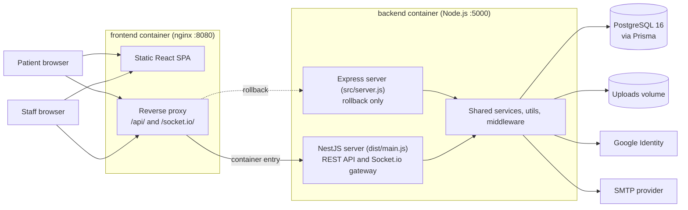

# Shifa | Healthcare Facility Management System

Shifa is a bilingual healthcare facility management product. Set optional `FACILITY_NAME_AR`
and `FACILITY_NAME_EN` deployment variables to show the institution's name prominently; each
language falls back to the Shifa product name when its facility name is unset. No facility name
is assumed or supplied by this repository.

The repository contains a Node.js/Prisma backend (NestJS in production, with the earlier Express server kept for rollback) and React/Vite frontend. The active database
provider is PostgreSQL. Development, test, staging, and production must use separate databases
or tightly isolated schemas; uploads use independent durable storage.

See [DEPLOYMENT.md](DEPLOYMENT.md) for deployment prerequisites and [OPERATIONS.md](OPERATIONS.md)
for backup, restore, monitoring, rollback, and incident procedures. Never commit `.env` files,
database files, backups, or uploaded clinical attachments.

## Configure insurance providers

1. Sign in as an administrator. Open **Doctors & catalogs**, then choose **Insurance providers → Add** in Clinic setup.
2. Enter the insurer’s Arabic and English names, the patient copay percentage, and the claim billing cycle in days. For example, a 20% copay on an eligible SDG 10,000 bill gives the patient a share of SDG 2,000 and the insurer a share of SDG 8,000.
3. Set **Active** and save. In **Reception → Billing**, select the insurer and check the displayed patient and insurer shares before issuing the invoice.
4. To retire a provider, open its entry, choose **Edit**, turn off **Active**, and save. Existing invoices and claims retain their amounts.

## Bill a doctor’s order

During a consultation, the doctor can select tests from the laboratory catalogue, skip tests when none are needed, and enter the prescription afterward. For a procedure or other clinical service, the doctor selects the service and quantity.

In **Reception → Billing**, select the patient and open the relevant doctor order. Check the charges, choose the insurer if applicable, and review the patient share. To remove an erroneous service charge before issuing the invoice, choose the line’s removal action and confirm a reason. The original medical order and the reason remain on record. If every charge is removed, the order cannot be invoiced.

Open laboratory orders from the lab billing queue. A fully covered order can be settled with zero patient payment. To correct an eligible issued consultation or lab invoice, open **View Invoice → Review refund**. Check the invoice, amount and reason before confirming. Consultation refunds close when the doctor starts the visit, and laboratory refunds close when sample collection begins.

## Bill and dispense clinic prescriptions

Pharmacy bills against the prescription created during a clinic visit. For a walk-in who needs a clinic prescription, reception first registers or selects the patient and checks them in. Once the doctor prescribes the medicines, open the prescription in the pharmacy queue, resolve any items awaiting review, check the invoice, and record payment. Dispense against the paid prescription so the stock movement, payment and patient record refer to the same order.

In Pharmacy, open medicine management to edit a medicine or deactivate it. Deactivation preserves stock, historical records and issued invoices. It removes the medicine from new prescriptions. An unbilled prescription may require review. An administrator can set prices or reactivate a medicine.

Standalone retail sales without a clinic prescription are outside this workflow. If a payment attempt times out, reopen the prescription and check its outstanding balance before recording another payment.

## System architecture

The NestJS application (`backend/src/main.ts`, built to `backend/dist/main.js`) is the production
server and the one the backend image starts. The earlier Express server (`backend/src/server.js`) is
still in the image as a rollback until it is removed. Both servers use the same domain services,
utilities, and middleware, and the parity tests in `backend/test/nestjs-*.test.js` compare their HTTP
and Socket.io behavior. Nothing in the code selects between them at runtime. The entry file that is
started decides which server runs.



### Components

| Component | Location | Responsibility |
| --- | --- | --- |
| Frontend SPA | [frontend/src](frontend/src) | React 19 + Vite app with a public landing page, a patient portal, and the staff workspace. Uses MUI, i18next (Arabic and English), and Socket.io client. |
| Frontend proxy | [frontend/nginx.conf](frontend/nginx.conf) | Serves the built SPA and forwards `/api/` and `/socket.io/` to the backend. Sets the Content-Security-Policy and other security headers. |
| Express server | [backend/src/server.js](backend/src/server.js) | Rollback entry point (`node src/server.js`, or `npm run start:express`). Express app with security headers, CORS, request IDs, the Socket.io server, and REST routes mounted under `/api`. Scheduled for removal once NestJS has run stably in production. |
| NestJS server | [backend/src/main.ts](backend/src/main.ts) | Production entry point (`node dist/main.js`). `createApp()` builds the app from [AppModule](backend/src/app.module.ts) and the feature modules in [backend/src/modules](backend/src/modules) with the same HTTP edge as Express: no `X-Powered-By`, one-hop proxy trust when `TRUST_PROXY=true`, security headers, CORS, and a global `/api` prefix. On SIGTERM or SIGINT it stops socket revocation, closes HTTP and Socket.IO, then disconnects Prisma, and exits 0. Built with `npm run build:nest`. |
| Realtime gateway (NestJS) | [backend/src/modules/realtime](backend/src/modules/realtime) | Socket.io gateway with the same handshake authentication, readiness gate, and rooms as `server.js`. |
| Shared backend code | [backend/src/services](backend/src/services), [backend/src/utils](backend/src/utils), [backend/src/middleware](backend/src/middleware) | Domain logic, utilities, and Express middleware. Nest modules call these directly, so both servers share one implementation. |
| Nest common layer | [backend/src/common](backend/src/common) and [backend/src/database](backend/src/database) | Global guards, exception filter, Zod pipe, decorators, request ID middleware, and the Prisma module. |
| Database | [backend/prisma/schema.prisma](backend/prisma/schema.prisma) | PostgreSQL schema with migrations in `backend/prisma/migrations/`. |
| Uploads | `UPLOAD_DIR` (`/app/uploads` in Docker) | Attachments stored on a separate durable volume, not in the database. |

### Backend layers

Requests move through these layers. The NestJS stack serves production. The Express stack is kept for
rollback and sits on the same services.

Express stack:

1. **Routes** ([backend/src/routes](backend/src/routes)): one module per area, such as `auth`, `patients`, `appointments`, `records`, `billing`, `pharmacy`, `admin*`, `patientAuth`, `mfa`, and `specialties`.
2. **Middleware** ([backend/src/middleware](backend/src/middleware)): authentication, role and policy checks, and request validation with Zod.
3. **Services** ([backend/src/services](backend/src/services)): business logic for MFA, access tokens, verification (email or phone), Google identity, patient registration, payments, pharmacy invoices, doctor scheduling, and socket revocation.
4. **Utilities** ([backend/src/utils](backend/src/utils)): clinic time zone handling, money arithmetic, scheduling rules, encryption of clinical data, notifications, and public DTOs that strip internal fields.
5. **Data access**: Prisma Client against PostgreSQL.

NestJS stack:

1. **Modules** ([backend/src/modules](backend/src/modules)): one folder per area, typically with a `*.module.ts`, `*.controller.ts`, and `*.service.ts`.
2. **Global guards and filters** ([backend/src/common](backend/src/common)): `JwtAuthGuard`, then `MustChangePasswordGuard`, then `RolesGuard`, registered in `AppModule`. Routes marked `@Public()` skip the auth guard. `ApiExceptionFilter` returns the same error envelope as the Express error handler. `RequestIdMiddleware` assigns request IDs.
3. **Validation**: `ZodValidationPipe` ([backend/src/common/pipes](backend/src/common/pipes)) validates request bodies in controllers.
4. **Services**: module services call the shared services and utilities listed above.
5. **Data access**: `PrismaModule` and `PrismaService` in [backend/src/database](backend/src/database).

### Frontend structure

- [frontend/src/app/router/AppRouter.jsx](frontend/src/app/router/AppRouter.jsx) defines the routes. `/` is the public landing page. `/patient-login`, `/register`, `/forgot-password`, and `/patient/claim` are patient auth pages. `/patient/*` is the patient portal behind `PatientRoute`, and `/staff/*` serves the staff workspace.
- Feature folders in [frontend/src/features](frontend/src/features) are grouped by audience. `public` holds the landing page, `patient` holds `auth` and `portal`, and `staff` holds `admin`, `clinical`, `doctor`, `laboratory`, `pharmacy`, `reception`, and shared `components`.
- Shared services in [frontend/src/services](frontend/src/services) include the API client (`apiClient.js`), token storage (`authStorage.js`), and logout. [frontend/src/services/staff](frontend/src/services/staff) holds the staff API, login, MFA, and Socket.io connection.

### Domain model

The Prisma schema covers these areas:

- **Identity and access:** `User`, `UserExternalIdentity`, `PendingExternalAuth`, `MfaConfiguration`, `MfaRecoveryCode`, `MfaChallenge`, `VerificationChallenge`, and `TenantAuditLog`.
- **Patients:** `Patient`, `PatientRegistration`, `PatientClaimCode`, `Consent`, and `MedicalRecord`.
- **Scheduling:** `Doctor`, `DoctorSchedule` with its periods, breaks, and exceptions, `Specialty`, `Appointment`, and `EmergencyOverride`.
- **Clinical:** `Prescription`, `PrescribedDrug`, `DrugFormulary`, `ClinicalService`, `LabOrder`, and `LabOrderItem`.
- **Pharmacy:** `InventoryBatch` and `StockMovement`.
- **Billing:** `Invoice`, `InvoiceItem`, `Payment`, `PaymentMethod`, `PaymentOperation`, `Refund`, `InsuranceCompany`, and `InsuranceClaim`.
- **Notifications:** `Notification` and `NotificationLog`.

### Security and realtime

- Staff roles are `ADMIN`, `RECEPTIONIST`, `DOCTOR`, `LAB_TECH`, and `PHARMACIST`. Patients use a separate login path.
- Staff accounts support multi-factor authentication. Recovery codes are stored hashed.
- Clinical data is encrypted with `MEDICAL_ENCRYPTION_KEY`. MFA secrets use `MFA_ENCRYPTION_KEY`.
- Socket.io connections authenticate with the same access token as the REST API. Both servers use the same socket authentication and revocation logic. When a user's auth version changes, their sockets from the stale auth generation are disconnected.
- Socket clients join rooms by user, role, and doctor (`user_<id>`, `role_<ROLE>`, `doctor_<id>`), so updates reach only the relevant staff. The NestJS gateway joins the same rooms.
- `/api/health`, `/api/health/live`, and `/api/health/ready` are served by both servers. Readiness also requires the socket revocation listener to be ready.
- Phone or email verification is controlled by `VERIFICATION_PROVIDER` (`email`, `disabled`, or `development` outside production). Production accepts only `email` or `disabled`.

### Deployment topology

- **Docker Compose** ([docker-compose.yml](docker-compose.yml)) runs three services: `postgres` (PostgreSQL 16), `backend` (Node 22), and `frontend` (nginx). The backend starts only after the database health check passes. The backend image is built from [backend/Dockerfile](backend/Dockerfile). Its runner stage starts NestJS (`node dist/main.js`). Express (`src/server.js`) is still in the image; to roll back, override the container command with `["node", "src/server.js"]`. The compose file does not override the command.
- **LAN profile** ([compose.lan.yml](compose.lan.yml)) runs the app on an internal network. The database and app networks are internal and not reachable from outside. It adds one-time bootstrap, first-admin, and backup services, with scripts in [deploy/lan](deploy/lan). It builds the same backend image.
- **Running locally:** `npm run dev` runs NestJS in watch mode. `npm start`, `npm run start:staging`, and `npm run start:nest` run the compiled app, so run `npm run build:nest` first. `npm run start:express` and `npm run dev:express` run the Express server for rollback checks.
- **CI/CD** ([.github/workflows/ci-cd.yml](.github/workflows/ci-cd.yml)) builds the NestJS app, runs backend tests (including the NestJS parity tests), frontend tests, lint, and build, then builds the Docker images.

## Local validation

```sh
cd backend && npm ci && npm test
cd frontend && npm ci && npm run lint && npm run build
cd backend && npx prisma validate && npx prisma migrate status
```

Copy the example environment files for local development and replace placeholders locally.
Production must use a secret manager or platform-injected environment variables.
