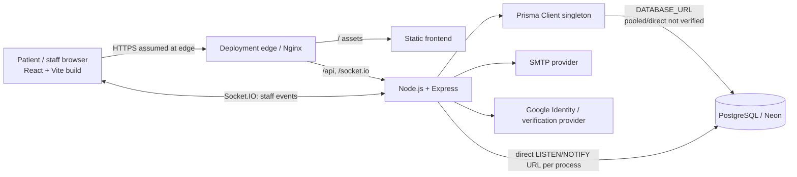

# Architecture baseline

**Frontend.** React 19, Vite 8, React Router 7, MUI 9/Emotion with Stylis RTL, Cairo/Inter variable-family assets, lucide icons and Recharts. Theme and language are persisted in `localStorage`; auth bearer token and user objects are held in `sessionStorage`. `AppRouter` statically imports patient auth and patient workspace routes; only the legacy staff app and public landing are route-lazy, while role workspaces inside the staff app are further lazy. No service worker, PWA manifest, offline cache or HTTP API response cache was found. Patient dashboard polling re-fetches pending appointment state every 45 seconds while pending. Staff uses Socket.IO for queue/notification updates and reconnect logic.

**Backend.** Node.js 22 target, Express 4, JSON API with route modules, Prisma Client 5 and PostgreSQL. `server.js` composes middleware/routes and a Socket.IO server. Security headers, exact CORS origin configuration, validation, role/ownership middleware, request IDs and graceful shutdown exist. JWT auth uses bearer headers; the verifier checks user status, role and auth version in the database per protected request. Rate limiters use the express-rate-limit process-local store. Multer uses memory storage with a 10 MB limit and file-signature checks. SMTP, Google Identity and optional verification integrations are environment-configured.

**Database.** `backend/prisma/schema.prisma` declares 41 models; 26 migrations are present in the repository at audit time. Important indexes exist for appointment date/doctor/patient access, queue-related clinical records, inventory, billing and patient histories. One recent migration adds six patient workflow indexes. No production/staging data, EXPLAIN plan, DB connection limit or pool setting was read. `DATABASE_URL` may be pooled depending on deployment configuration; `SOCKET_REVOCATION_DATABASE_URL` requires a direct/session-capable connection and creates a PostgreSQL LISTEN client per backend instance.

**Deployment.** Root Compose runs PostgreSQL, backend and Nginx frontend; it publishes backend port 5000 and frontend port 8080 and contains no TLS termination, external backup, HA or monitoring service. Nginx proxies `/api` and `/socket.io`; CSP and several browser headers are configured there, but the file has no explicit gzip/Brotli or static cache policy and does not set HSTS. TLS must come from a production edge. Compose uses one DB identity for runtime and app connection; least privilege is not enforced there. GitHub Actions runs backend tests against a PostgreSQL service, frontend tests/lint/build and Docker image builds without publishing. No load/security/restore job exists.

**Single points of failure and horizontal assumptions.** One backend process and its local rate limiter, in-process Socket.IO rooms, one direct revocation listener and one configured DB path are implicit. Multi-instance deployment can lose cross-instance queue broadcasts and makes rate limits per-instance unless a shared adapter/store is added. Browser polling provides some eventual refresh but is not a substitute for shared event delivery. Upload volume is local persistent storage in Compose and needs private durable backup/object-storage design in a managed topology.
